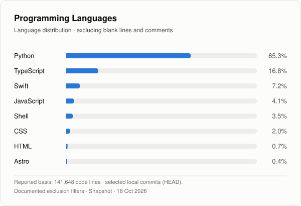

# BenjMARK

### Software Engineering · AI Systems · Automation

**Building intelligent systems, native applications and modern software infrastructure.**

 

---

## About Me

Independent developer focused on software architecture,
artificial intelligence, local language models and automation.

My work combines native application development,
web technologies, AI infrastructure and intelligent workflows.

## Tech Stack

### Programming Languages

### Frameworks & Development

### AI & Local LLMs

### Infrastructure & Tools

---

## Development Focus

- Native macOS and iOS applications
- Local AI systems and large language models
- AI-assisted software engineering
- Backend services and API integration
- Workflow automation and system architecture
- Data processing and visualization

---

## Language Distribution

As of 18 Oct 2026. Reported basis: 141,648 lines of code,
excluding blank lines and comments, from selected local commit snapshots.
Dependencies, build artifacts and detected generated code were excluded
using documented filters. Different versions of the same tools may be
counted more than once.

This is a local snapshot, not a complete GitHub activity or code authorship
statistic. Fork status has not been fully verified for all analyzed
repositories.

---

**BenjMARK · Software · Intelligence · Systems**

